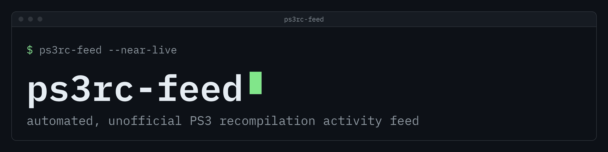

  

# ps3rc-feed

An automated, unofficial activity feed for PS3 recompilation projects on GitHub.

  
  
  
  
  
  

**Live page:** <https://undecuple.github.io/ps3rc-feed/>. It shows real collected data, refreshed every 6 hours by a
scheduled job when that is enabled, and otherwise published by hand. It is not
real time, and the page shows its own collection time. The last collection may be incomplete, and the page says so.

## What it is and is not

- An automated, unofficial index. Project discovery, game associations, toolkit detection and descriptions may be
  wrong, incomplete or out of date. Those labels are inferred.
- A listing does not mean a project is playable, official, safe or endorsed, and does not verify who wrote it.
  Follow the link and read the project's own pages.
- It reports observed repository activity from public GitHub data, not game compatibility or project quality.
- It does not host game files, binaries or builds.

## What exists

- **Live page** in `site/`: a feed, a catalog table, a fork view, a recent view and a games view, with filters, search, sorting by clicking a column
  heading, a stars column, and headings that stay visible while scrolling. Forks with no stars and no recent commits are hidden until you search or switch them on. Details are in `site/README.md`.
  If the page misses a repository, a reviewed change to the config adds a search term or an include entry, and a later collection picks it up.
- **Collector** in `collector/`: a Python standard-library program, developed and tested on Python 3.14. It makes
  read-only GET requests to `api.github.com` with a hard request budget and stops on rate limits.
- **Event model:** repositories are tracked by GitHub repository ID, and the first run is a baseline that creates no
  events. Unknown values stay `null`. Incomplete collection is flagged as incomplete.
- **Forks:** fork networks are followed from configured root repositories. A game association inherited from a parent
  is labelled inherited and unverified.
- **Export:** `export` turns run files into the `feed.json` and `manifest.json` the page reads, and can keep its state
  between runs. See [docs/export.md](docs/export.md).
- **History:** `history` appends each published feed to the `feed-history` branch. See [docs/history.md](docs/history.md).
- **Discord:** `discord` prints which Discord messages a feed would produce; `discord --send` posts them to the webhook in `DISCORD_WEBHOOK_URL`. Nothing in the workflows calls it yet. See [docs/discord.md](docs/discord.md).
- **Atom feed:** the deployed site serves `feed.atom` with the newest new repositories and releases. See [site/README.md](site/README.md).
- **Tests:** offline unit tests in `tests/` run in CI. They block network access.

Not built yet: the workflow job that sends to Discord (nothing posts automatically).

## Using it

    python3 -B -m unittest discover -s tests

    # request plan only, no network
    python3 -B -m collector collect --config config/sources.json

    # live, read-only GET requests to api.github.com
    GITHUB_TOKEN=... python3 -B -m collector collect --config <your config> --live \
        --max-requests 300 --out data/run.json

    # the same, with the fetch order taken from the state the export keeps (see "Fetch order")
    GITHUB_TOKEN=... python3 -B -m collector collect --config <your config> --live \
        --max-requests 300 --out data/run-003.json --previous-state data/state.json

    # site feed from run files, no network
    python3 -B -m collector export --runs data/run-001.json --out-dir data/site

    # next time: apply one new run on top of the saved state
    python3 -B -m collector export --runs data/run-002.json --out-dir data/site --overwrite \
        --state-in data/state.json --state-out data/state.json --stale-after-minutes 1500

A live run needs `--max-requests` and `--out` under `data/`, and either `GITHUB_TOKEN` or `--anonymous`. A token with
no permissions is enough for public data. Put it in the environment of the command and never in a file. The token must
be 1-4096 characters of letters, digits, `_`, `-` and `.`: classic `ghp_` and `github_pat_` tokens fit, and so does the
Actions `GITHUB_TOKEN` (`ghs_` and a dotted text of about 520 characters). Anything else is refused with the allowed
form and the observed length only, never any character of the value. The collector
refuses the placeholder example config. A token GitHub rejects (HTTP 401 on any request) stops the run at once with
stop reason `unauthorized`, prints "token rejected by GitHub (401); check or regenerate the token" and exits 3; such
a run is never published. The live write path uses POSIX file operations, so it targets Linux and macOS.

`data/` is ignored by git. Run files are never committed.

| Exit code | Meaning |
| --- | --- |
| 0 | complete (for `export`: files written) |
| 1 | error (for `export`: an invalid run or state file) |
| 2 | refused |
| 3 | partial, for example stopped by the budget, a rate limit or a rejected token (401) |

`config/sources.example.json` holds fictional placeholders only. `config/sources.json` holds the reviewed roots and
search queries.

## Sources config

`config/sources.json` is the reviewed config the scheduled job uses. `config/sources.example.json` shows every key
with fictional placeholders only; a live run refuses any config that still uses one of them. Every key is checked
strictly (types, lengths, counts, no unknown keys, no control characters), and error messages name paths and counts,
never values from the file.

- `queries`: GitHub search queries, at most 50. An entry is a plain string, or `{"q": "<query>", "require_any":
  ["term", ...]}`: a result is then kept only when its `owner/name` or its description contains at least one term
  (plain substring, case-insensitive, name and description matched separately). Both come with the search result,
  so a result left out costs no request; it is not recorded in the run, and the number left out is the search
  entry's `filtered_out` and the run's `collection_report.filtered_out`. Terms: 1 to 50 per query, 1 to 64 printable
  characters each, single inner spaces only, no duplicates. Pick terms that name the game, not the word the query
  searches for (a `helghast` query must not use `helghast` as a term, or every result passes), and never list
  repository names as terms: use `include` for one repository.
  A code query is `{"kind": "code", "q": "<code search query>"}`, with an optional `require_any` matched the same way
  against the name and description of the repository holding the file. It asks GitHub's code search (`GET
  /search/code`) and finds repositories by a file they contain, for example one that vendors a licence file without
  naming the toolkit in its name or description. Its entry in the run says `"kind": "code"`; that records how the
  repository was found, not that it is a recompilation. Code search needs a token: with `--anonymous` code queries are
  left out of the plan (it says how many in `skipped_code_queries`) and not asked, and the run is incomplete (the
  search entry says `"skipped": "no_token"`, the report counts `skipped_searches`). Code search has its own rate limit
  (about 10 requests a minute), separate from the search limit, so either running out leaves the other kind going.
  A secondary limit on code search (a 403 or 429 with `retry-after`, or a 429 while requests are left) ends code
  search only, after up to two retries of the same request (three attempts in all). Before the first retry the
  collector waits `retry-after` seconds, or 5 seconds when the answer has none; before the second it waits the larger
  of the new `retry-after` and twice the first wait, plus up to 1 second of random jitter. No single wait is longer
  than 30 seconds: a `retry-after` above 30 is not waited for, and the code search gives up at once. All code search
  waits of one run together stay within 60 seconds; a wait that would pass that is not made. Each retry counts in
  the request budget and is logged like any other request, and when the budget is spent nothing is waited for. When
  the collector gives up, it marks that code search and the later ones incomplete and goes on with the repository
  searches and fetches. A secondary limit anywhere else still stops the run.
  Repository search items carry no README text: a query with `in:readme` cannot use `require_any` and stays a plain
  string.
- `roots`: `{"repository_id", "full_name"}` repositories whose fork network is walked.
- `include`: `{"repository_id", "full_name"}` repositories fetched even when no search or fork walk returns them.
  They cost the same four requests as any candidate (metadata by id, commits, releases, readme) and no lookup.
- `deny`: `{"repositories": ["owner/name", ...], "owners": ["login", ...]}`, matched case-insensitively against the
  name the listing gave, before anything is fetched. Denied ids are left out of the run's listings and counted in
  `collection_report.denied`. Roots and included repositories cannot be denied (the config is refused).
  `export --config` also removes a denied repository and its events from the saved state and the feed, so a
  repository found before it was denied leaves the page and the next history append; the history archive keeps the
  lines already written.
- `max_requests`, `max_repositories`, `commit_window_days`, `readme_bytes`, `page_caps` (`search`, `code` (1 to 3,
  default 1), `forks`, `commits` pages per listing): the budget. A repository costs about four requests; candidates are
  fetched in the fetch order below and those past `max_repositories` are reported as not fetched.

### Fetch order

When there are more candidates than `max_repositories` (or the budget stops the run), the order decides which are
left out. It is deterministic and needs no network:

1. Roots and `include` entries, ascending id. The config names them, so they always come first.
2. Candidates never attempted before, newest (highest) id first, so a newly found repository is fetched first.
3. Candidates attempted before, oldest last attempt first, ties by ascending id. A repository left out of one run
   is among the first of the next, so the cut rotates.

"Attempted before, and when" comes from `--previous-state <state .json under data/>`: the state `export --state-out`
keeps. Only its repositories' `last_attempted_refresh_at` values are read, and the file is never written. It follows
the `--state-in` path rules; a missing or unusable file is refused before any request (exit 2, or 1 for a file that
is not a valid state), and `--out` may not name it. Without the flag every candidate counts as new, so the order is
roots and `include`, then newest id first, and the same repositories are left out every run. The request plan, the
`--recorded` plan and the live summary carry `previous_state` (`known_repositories`, `last_run_at`) when the flag
is given. A daily job runs `collect --previous-state data/state.json`, then `export --state-in data/state.json
--state-out data/state.json --overwrite` with the new run.

A repository left out is simply absent from the run: the run is partial (`complete` false, `not_fetched` counts
it), the export keeps its previous values, and it is listed as not refreshed, not as failing. When more new
repositories turn up every run than there are free places, the lowest new ids wait until fewer new ones arrive.

GitHub answers 409 on the commits listing of an empty repository, but a 409 can also mean the repository is
temporarily unavailable. Such a repository is recorded with no commits and `commits_complete` false (zero is not
taken as certain), counted in `collection_report.commits_unavailable`, and does not make the run partial; any other
incomplete commits listing (a page cap, dropped items) still does.

### Reviewing a change to `config/sources.json`

1. Run `python3 -B -m collector collect --config config/sources.json` (no network): the config must load, and the
   plan lists one search per query (`/search/code` for a code query), one forks walk per root and one metadata
   request per root and include entry.
2. Check the budget: `max_requests` stays under the token's hourly limit with margin (the job's built-in token
   allows 1000 requests an hour, search 30 a minute, code search 10 a minute), and repository searches x
   `page_caps.search` + code searches x `page_caps.code` + roots x `page_caps.forks` + 4 x `max_repositories` fits in
   `max_requests`. The committed config has no code query: code search answered 429 on every run with the built-in token, so it stays an option for other configs, not a source here.
   The fetch order changes which candidates are fetched, not how many, and `--previous-state` costs no request.
   With 190 places, two runs reach every candidate while there are at most 380 (fewer by the roots and `include`
   entries, which take a place in every run).
3. For a new or changed `require_any`, list which repositories of a recent run file the terms keep and which they
   drop, and say why for every borderline case. Terms describe the game; repository names are not terms.
4. Update the expectations in `tests/test_sources_config.py` in the same change, and run the tests.

## Game aliases

Game names come from `config/games.json`, a reviewed list of games. Each entry has a `key`, a `title`, `aliases` and
optionally `name_patterns` and `platform`. An alias matches whole words, ignoring case and accents, in the repository
name (split on `-`, `_`, `.`, camelCase and between letters and digits), then the description, then the README title;
the first of these with a match wins, and the longest alias wins inside one of them, so "gow" never matches "gowild"
and "infamous 2" wins over "infamous". A name pattern must match the whole repository name, `*` standing for one word.
A match on the name or description has confidence `strong`, on the README title `medium`, and the feed records the
alias that matched (`matched_alias`). A fork without a match of its own takes its parent's match. A repository that
matches nothing keeps its first README heading as an unreviewed name with confidence `low`, which the page may hide.
Changing a repository's label through this list does not create events: `game_association_changed` is reported only
when the game key changes between two runs that both used the list.

To add a game, open a pull request that adds one entry: aliases that name only this game, written as they appear in
repository names or descriptions, and a name pattern for a name too short to be a safe alias. The loader refuses
unknown keys, duplicates (also across entries and spellings), markup, control characters and oversized lists. Then:

1. Run `python3 -B -m collector games` (offline): the file must load.
2. With a state saved by `export --state-out` under `data/`, run
   `python3 -B -m collector games --state data/state.json` to print every repository whose label would change. Say
   why in the pull request for each change that is not obviously the same game.
3. Update the expectations in `tests/test_games.py` and run the tests.

## Search terms and the relevance filter

Searching for game names also matches unrelated repositories. A search for a word like "killzone" returns trading
scripts, class projects and profile pages next to the few repositories about the games. A query can therefore list
`require_any` terms, and only results whose name or description contains one of them are kept. The rules are in
"Sources config" above.

## Scheduled refresh

`.github/workflows/refresh.yml` refreshes the feed on GitHub runners with the built-in token. It runs only when the
repository variable `REFRESH_ENABLED` is `true`. Until the maintainer sets it, every job is skipped and the page keeps
the data published by hand.

When it runs, it starts every 6 hours at 17 minutes past the hour, or by hand from the Actions tab. One run:

1. Collects with `--max-requests 800`.
2. Exports on top of the state saved by the previous run.
3. Checks the run. An abnormal stop publishes nothing: when the run stopped for anything but the request budget
   (`rate_limited`, `search_rate_limited`, `code_search_rate_limited`, `network`, `unauthorized`) or the feed lists no repositories,
   the collect job prints the reason and fails, and nothing is pushed or deployed.
4. Saves `state.json`, `feed.json` and `manifest.json` on the `feed-state` branch. Each run replaces the branch with
   one commit. Run files are never committed. A feed with under half the repositories of the committed
   `site/data/feed.json` is refused.
5. Runs the site tests and deploys the page with the new feed, except after a first run.
6. Adds the run to the `feed-history` branch, on a first run too. This job runs beside steps 4 and 5, and its
   failure does not stop them.

A run makes at most 800 requests, and four runs a day make at most 3,200. Scheduled runs start 6 hours apart and
never overlap, so an hour holds at most one of them, under the token's limit of 1,000 requests an hour. A run started
by hand adds up to 800 more, and the collector stops when it reaches a rate limit.

Code search on the Actions token: its secondary limit is observed, not documented. GitHub publishes no figure for
the built-in token, so the collector's handling follows what live runs showed. The first code search request
answered 429 with `retry-after: 2` in one run and `retry-after: 12` in the next, with 10 code search requests left
both times. The collector now waits up to 30 seconds per retry, retries at most twice and waits at most 60 seconds
in a run, which fits in the collect job's 45 minute timeout. When the limit persists, the code search entry is
incomplete and the rest of the run is published.

The first run finds no `feed-state` branch. It then starts from an empty state, so its feed is a baseline with no
events. It pushes `feed-state` but does not deploy. After the first run, review `feed.json` on the `feed-state`
branch, then deploy it by starting the `pages` workflow by hand (Actions tab, `pages`, Run workflow); that workflow
serves the `feed-state` feed when it passes the same checks. A push to `main` deploys the page with the feed from `feed-state` when that feed matches its manifest, and
with the committed `site/data/` otherwise.

## History

The `feed-history` branch keeps every event the feed has shown. It also keeps each change of a repository's name,
stars, commits in the last 30 days, category, archived and fork flags, and last commit time. It has one file per
month. History is written only when the scheduled refresh runs. The `history` command adds a feed to it, and the
refresh job pushes the result with normal commits. The format, the size limits and the rotation rules are in
[docs/history.md](docs/history.md).

## How AI was used

Most of the code, tests and documentation were written with AI agent assistance (Claude Code). Changes go through
review and CI before they are merged, and the page labels what the data is.

## Related projects

- [ps3recomp](https://github.com/sp00nznet/ps3recomp), the toolkit whose fork network the collector follows.

## Licence

[MIT](LICENSE). The banner and social preview are text-only renders set in IBM Plex Mono (SIL Open Font License 1.1).
