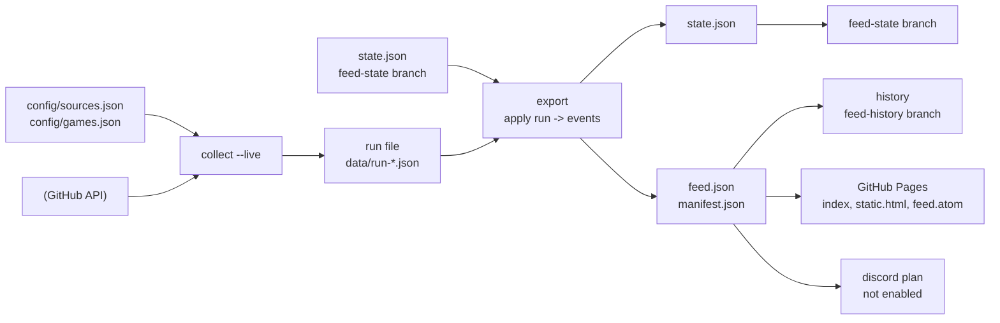
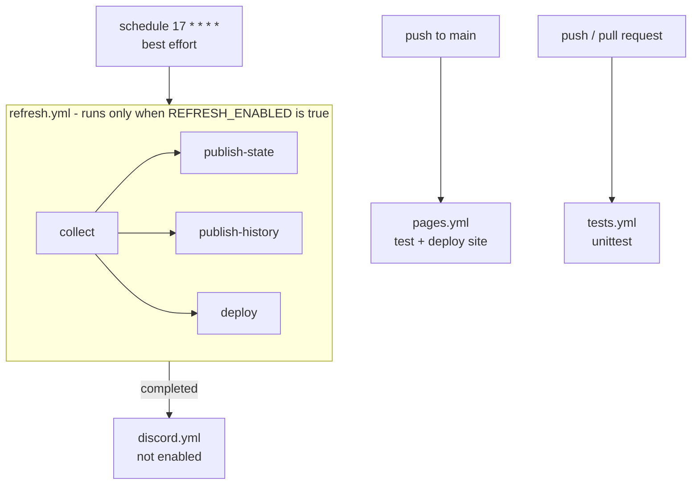

# Code map

How the code is laid out, how data moves through it, and where to start when you change something.
Python 3.14 standard library only for the collector; Node 20 or newer (no dependencies) for the site and its tests.

## Layers

```mermaid
flowchart TB
  subgraph net["Network - the only code that opens a connection"]
    github["collector/github.py<br/>HTTPS GET to api.github.com"]
    dsend["collector/discord_send.py<br/>HTTPS POST to one webhook"]
  end
  subgraph drive["Driving"]
    cli["collector/cli.py<br/>commands"]
    collect["collector/collect.py<br/>searches, fetches, run file"]
  end
  subgraph pure["Pure: no network, no clock"]
    schema["schema.py<br/>strict JSON checks"]
    store["store.py<br/>state file"]
    events["events.py + model.py<br/>diff run vs state, event ids"]
    forks["forks.py<br/>fork network"]
    games["games.py<br/>alias matcher"]
    catalog["catalog.py<br/>catalog + sorting"]
    text["text.py<br/>escape untrusted text"]
    export["export.py<br/>feed.json, manifest.json"]
    history["history.py<br/>feed-history archive"]
    discord["discord.py<br/>plan messages"]
  end
  subgraph site["Static site - site/"]
    terminal["terminal.js<br/>views, commands, joinData"]
    app["app.js<br/>page glue, fetch feed"]
    render["tools/render_static.js<br/>tools/render_atom.js"]
  end
  cli --> collect --> github
  cli --> events & export & history & discord
  collect --> schema
  events --> store & forks & games & text & model
  export --> catalog
  discord --> dsend
  export -. feed.json .-> terminal
  export -. feed.json .-> render
  app --> terminal
```

Rules the layers keep: only `github.py` and `discord_send.py` open connections, and repository text is untrusted, so it
passes `text.escape_text` before it reaches a renderer-facing field. The Python tests block sockets at import
(`tests/helpers.py`), and a test checks that `discord.py` has no network or clock code.

## Data flow of one refresh



1. `collect` (cli) runs the configured searches and fork walks within a request budget and writes one run file.
2. `export` loads the saved state (or starts empty: the first run is a baseline and emits no events), applies the run
   through `schema.validate_run` and `events.apply_run`, builds the catalog and writes `feed.json`, `manifest.json`
   and the new state.
3. The workflow checks the output before anything is published, then three jobs run: publish the state to the
   `feed-state` branch, append to the `feed-history` branch (`history`), and deploy the site with the feed overlay.
4. The deploy step renders `static.html` and `feed.atom` from the feed (`site/tools/render_*.js`).

## Control flow of the workflows



## Entry points

| Entry | Where | What it does |
|---|---|---|
| `python3 -m collector <cmd>` | `collector/__main__.py` to `cli.main` | `dry-run`, `collect`, `export`, `history`, `games`, `discord` (see `collector/cli.py` docstring) |
| Page | `site/index.html` loads `app.js`, `terminal.js` | the terminal-style views |
| Static list | `node site/tools/render_static.js <feed> <out>` | one HTML file, no script |
| Atom feed | `node site/tools/render_atom.js <feed> <out>` | newest 100 discovered/release events |
| Browser check | `sh site/tools/browser_check.sh` | headless Chromium, local only |

## Modules

| File | Job |
|---|---|
| `schema.py` | strict schemas for run files, state and events; bounded text |
| `store.py` | persisted observation state, canonical JSON |
| `model.py` | event types, deterministic ids |
| `events.py` | diff a run against the state, noise controls, baseline rule |
| `forks.py` | ancestry, inherited game and toolkit labels, comparisons |
| `games.py` | reviewed alias list matcher (`config/games.json`) |
| `catalog.py` | catalog view, null-aware sorting |
| `text.py` | escaping of untrusted text |
| `export.py` | state to `feed.json` / `manifest.json` |
| `history.py` | append-only archive (`docs/history.md`) |
| `discord.py` / `discord_send.py` | plan messages / send them (docs/discord.md) |
| `github.py` | read-only client with URL and redirect checks, rate-limit handling |
| `collect.py` | drive the client, adapt responses to the run format |
| `paths.py` | repository paths |

## Build and test map

| What | Command | Where |
|---|---|---|
| Python tests | `python3 -B -m unittest discover -s tests` | `tests/` (fixtures in `tests/fixtures/`, helpers in `tests/helpers.py`) |
| Site tests | `cd site && node --test` | `site/*.test.js`, fictional data in `site/testdata/` |
| Browser check | `sh site/tools/browser_check.sh` | needs Chromium; not run in CI |
| Dry run, no writes | `python3 -m collector dry-run tests/fixtures/<file>` | |

CI: `tests.yml` runs the Python tests on every push to main and every pull request; `pages.yml` runs the site tests before
it deploys. There is no build step for the site.

## Where to change what

- A new event type: `model.py`, `events.py`, `schema.py`, then `export.py`, `site/terminal.js` and the renderers.
- A new game name: `config/games.json` only (reviewed through a pull request), then `python3 -m collector games`.
- A new search: `config/sources.json`; the request budget is in the same file.
- A new site view: `site/terminal.js` (logic, tested in `terminal.test.js`) and `site/app.js` (glue).
- A workflow change: `.github/workflows/`; actions are pinned to full commit hashes, `tests/test_workflows.py` checks them.
